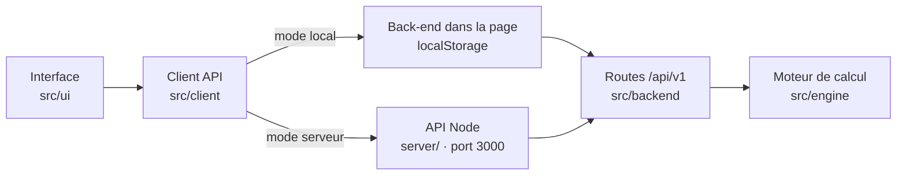

<div align="center">

# 🛒 QA Demo Store

**Une boutique en ligne fictive pour s'entraîner aux tests logiciels : fonctionnels, automatisés, API, accessibilité.**

[](https://github.com/maximejoannis/qa-demo-store/actions/workflows/ci.yml)
[](https://maximejoannis.github.io/qa-demo-store/)
[](CHANGELOG.md)
[](#-qualité-et-tests)
[](#-qualité-et-tests)
[](docs/tracabilite.md)

[](src)
[](index.html)
[](src/styles/main.css)
[](https://vitejs.dev/)
[](https://vitest.dev/)
[](https://nodejs.org/)
[](eslint.config.js)
[](https://prettier.io/)

[](package.json)
[](#-déploiement-sur-github-pages)
[](docs/qa/testids.md)
[](docs/design-tokens.md)
[](docs/rgpd.md)
[](src/i18n)
[](LICENSE)

**[🌐 Ouvrir l'application](https://maximejoannis.github.io/qa-demo-store/)** ·
**[📘 Guide du testeur](docs/qa/guide-testeur.md)** ·
**[📐 Règles métier](docs/specs/regles-metier.md)** ·
**[🔌 OpenAPI](public/openapi.json)**

</div>

> [!WARNING]
> Tous les comptes, produits, commandes et paiements sont **fictifs**. Ne saisissez jamais de vraie carte bancaire, de vrai mot de passe ni de données personnelles réelles.

---

## 📑 Sommaire

1. [Présentation](#-présentation)
2. [Démarrage rapide](#-démarrage-rapide)
3. [Les trois façons de lancer l'application](#-les-trois-façons-de-lancer-lapplication)
4. [Fonctionnalités](#-fonctionnalités)
5. [Pour les testeurs](#-pour-les-testeurs)
6. [Commandes npm](#-commandes-npm)
7. [Architecture](#-architecture)
8. [Qualité et tests](#-qualité-et-tests)
9. [Documentation](#-documentation)
10. [Déploiement sur GitHub Pages](#-déploiement-sur-github-pages)
11. [Dépannage](#-dépannage)
12. [Licence](#-licence)

---

## 🎯 Présentation

QA Demo Store est un **terrain d'entraînement QA**. Ce n'est pas une vraie boutique : chaque fonctionnalité existe pour être testée.

| Pour…                          | Ce que propose l'application                                                                                              |
| ------------------------------ | ------------------------------------------------------------------------------------------------------------------------- |
| **Tests fonctionnels manuels** | Un parcours d'achat complet, des règles métier documentées au centime près, six comptes contenant des défauts volontaires |
| **Tests automatisés E2E**      | Des `data-testid` stables, des états d'attente explicites, des données et une horloge pilotables par l'URL                |
| **Tests d'API**                | 40 opérations REST décrites en OpenAPI, des erreurs normalisées (RFC 9457), une API Node locale facultative               |
| **Tests d'accessibilité**      | Une interface WCAG 2.2 AA… et un compte qui la casse volontairement                                                       |
| **RGPD**                       | Consentement, export et suppression des données, durées de conservation et purge                                          |

L'application est écrite en **HTML, CSS et JavaScript vanilla** (modules ES), construite avec **Vite**, sans framework et sans aucune dépendance à l'exécution. Elle fonctionne entièrement sur **GitHub Pages**, gratuitement et sans service externe.

> Les tests unitaires (Vitest) sont dans ce dépôt. Les tests E2E **Playwright** vivent dans un projet QA séparé qui cible cette application.

---

## 🚀 Démarrage rapide

**Prérequis :** [Node.js](https://nodejs.org/) 22 ou 24 (version LTS) et [Git](https://git-scm.com/).

<details open>
<summary><b>Windows (PowerShell)</b></summary>

```powershell
git clone https://github.com/maximejoannis/qa-demo-store.git
cd qa-demo-store
npm ci
npm run dev
```

</details>

<details>
<summary><b>macOS / Linux</b></summary>

```bash
git clone https://github.com/maximejoannis/qa-demo-store.git
cd qa-demo-store
npm ci
npm run dev
```

</details>

Ouvrez ensuite **http://localhost:5173/qa-demo-store/**. Ajoutez `?qa=1` à l'adresse pour afficher la barre d'outils QA.

> [!NOTE]
> L'application doit être ouverte via `http://localhost:5173/qa-demo-store/` : ouvrir `index.html` directement (`file://`) ne fonctionne pas.

---

## 🧭 Les trois façons de lancer l'application

| Mode         | Commande(s)                                 | Adresse                                        | Où vit le back-end ?                           | Idéal pour                                      |
| ------------ | ------------------------------------------- | ---------------------------------------------- | ---------------------------------------------- | ----------------------------------------------- |
| **En ligne** | aucune                                      | https://maximejoannis.github.io/qa-demo-store/ | Dans la page, données dans le `localStorage`   | Tests fonctionnels, E2E, exploratoires          |
| **Local**    | `npm run dev`                               | http://localhost:5173/qa-demo-store/           | Dans la page, données dans le `localStorage`   | Les mêmes tests, hors ligne                     |
| **API Node** | `npm run server` **+** `npm run dev:server` | http://localhost:5173/qa-demo-store/           | Serveur Node local (port 3000), `data/db.json` | Tests d'API, cookies, CSRF, limitation de débit |

Les deux back-ends exécutent **le même code** (`src/backend`) : mêmes routes, mêmes règles, mêmes réponses. C'est vérifié par les tests de contrat `PARITY-*`.

Pour le mode API Node, ouvrez deux terminaux :

```powershell
# Terminal 1 : l'API sur http://localhost:3000
npm run server

# Terminal 2 : l'interface qui appelle cette API
npm run dev:server
```

---

## ✨ Fonctionnalités

### 🛍️ Boutique

- **Catalogue** de 18 produits : recherche, filtres (catégorie, prix, stock, note), 6 tris, pagination.
- **Fiche produit** : promotions datées, avis clients, niveau de stock, alerte de retour en stock.
- **Favoris**, **comparateur** (3 produits maximum), produits **consultés récemment** (avec consentement).
- **Panier** conservé 30 jours, codes promo, choix du mode et du pays de livraison.
- **Commande en 4 étapes** : adresse → livraison et points de fidélité → paiement (carte, à la livraison, en 3 ou 4 fois) → vérification.

### 👤 Compte client

- Inscription, connexion, verrouillage après 5 échecs, déconnexion.
- Profil, adresse par défaut, historique des commandes, **factures**, annulation, **retours** sous 14 jours.
- Programme de **fidélité** Bronze / Argent / Or.
- **Mes données** : export JSON, newsletter, suppression du compte.

### 🛠️ Administration (`admin_user`)

- Produits (prix, stock, activation), statuts des commandes.
- **Indicateurs (KPI)** sur une période, suggestions de **réapprovisionnement**, **purge RGPD**.

### 🧮 Moteur de calcul (côté back-end)

Tous les montants affichés sont calculés par le back-end, en **centimes entiers**, jamais par l'interface.

| Domaine   | Règles                                                                                                       |
| --------- | ------------------------------------------------------------------------------------------------------------ |
| TVA       | Prix TTC, 20 % par défaut, 5,5 % pour les livres, ventilation HT / TVA par taux                              |
| Remises   | `WELCOME10` (−10 %), `SAVE20` (−20 € dès 100 €), `FREESHIP`, réparties au prorata des lignes                 |
| Livraison | Standard, express ou retrait ; zones France / UE / Monde ; supplément au poids ; gratuite dès 50 € en France |
| Délais    | Jours ouvrés et 11 jours fériés français (dont Pâques et Pentecôte), heure de Paris                          |
| Fidélité  | 1 point par euro × multiplicateur du niveau, paliers sur 365 jours glissants                                 |
| Paiement  | En 3 ou 4 fois de 100 € à 2 000 €, reliquat sur la première échéance                                         |
| Retours   | Rétractation de 14 jours, remboursement au prorata, points retirés                                           |
| Pilotage  | KPI, réapprovisionnement, durées de conservation RGPD                                                        |

Le détail de chaque règle, avec des exemples chiffrés, est dans [`docs/specs/regles-metier.md`](docs/specs/regles-metier.md).

### 🔒 RGPD

Bandeau de consentement (« Tout refuser » aussi visible que « Tout accepter »), politique de confidentialité, droits d'accès, de rectification, d'effacement et de portabilité, durées de conservation et purge. Tout est **testable** : voir [`docs/rgpd.md`](docs/rgpd.md).

### 🎨 Interface

- Français et anglais (`?lang=en`), thème clair ou sombre.
- Accessibilité WCAG 2.2 AA : contrastes vérifiés, navigation au clavier, lien d'évitement, messages annoncés.
- Couleurs imposées (voir [`docs/design-tokens.md`](docs/design-tokens.md)), police Poppins hébergée dans le dépôt.
- Responsive : ordinateur, tablette, mobile.

---

## 🧪 Pour les testeurs

Tout est détaillé dans le **[guide du testeur](docs/qa/guide-testeur.md)**. L'essentiel :

### Comptes

| Compte          | Mot de passe | Particularité                                 |
| --------------- | ------------ | --------------------------------------------- |
| `standard_user` | `demo123`    | Client « normal », adresse à Lyon             |
| `premium_user`  | `demo123`    | Client niveau Argent (620 points)             |
| `admin_user`    | `admin123`   | Administrateur                                |
| `locked_user`   | `demo123`    | Compte verrouillé (connexion refusée)         |
| `problem_user`  | `demo123`    | 🐞 Défauts fonctionnels et visuels            |
| `glitch_user`   | `demo123`    | 🐞 Lenteurs et double soumission              |
| `error_user`    | `demo123`    | 🐞 Erreurs serveur et messages d'erreur       |
| `rounding_user` | `demo123`    | 🐞 Erreurs d'arrondi et de TVA                |
| `a11y_user`     | `demo123`    | 🐞 Défauts d'accessibilité                    |
| `i18n_user`     | `demo123`    | 🐞 Défauts de traduction et de format de date |

Les comptes 🐞 contiennent des **défauts volontaires** à trouver : voir [`docs/qa/comptes-de-test.md`](docs/qa/comptes-de-test.md).

### Cartes de test

| Numéro                | Résultat                  |
| --------------------- | ------------------------- |
| `4242 4242 4242 4242` | ✅ Paiement accepté       |
| `4000 0000 0000 0002` | ❌ Carte refusée          |
| `4000 0000 0000 0069` | ❌ Carte expirée          |
| `4000 0000 0000 0119` | ⚠️ Erreur technique (502) |

### Paramètres d'URL

| Paramètre                          | Effet                                                      |
| ---------------------------------- | ---------------------------------------------------------- |
| `?qa=1`                            | Affiche la barre d'outils QA                               |
| `?now=2026-12-31T23:59:30%2B01:00` | Fige l'horloge de l'application (encodez `+` en `%2B`)     |
| `?seed=42`                         | Numéros de commande prévisibles (`?seed=off` pour annuler) |
| `?lang=en`                         | Interface en anglais                                       |
| `?latency=2000`                    | Ajoute 2 s de latence à chaque appel                       |
| `?fail=quotes:503`                 | Fait échouer une route avec le code indiqué                |

### Scénarios de données

`default`, `empty-catalog`, `low-stock`, `order-history`, `loyalty-gold`, `rgpd-expired` : à choisir dans la barre QA ou via `POST /api/v1/demo/reset`.

### Exemple Playwright

```js
import { test, expect } from '@playwright/test';

test('ajouter un produit au panier', async ({ page }) => {
  await page.goto('/qa-demo-store/?seed=42&now=2026-10-12T10:00:00%2B02:00#/products');
  await expect(page.getByTestId('view')).toHaveAttribute('data-state', 'ready');
  await page.getByTestId('product-add-cart-3').click();
  await expect(page.getByTestId('cart-badge')).toHaveText('1');
});
```

Tous les sélecteurs sont listés dans [`docs/qa/testids.md`](docs/qa/testids.md) (122 `data-testid`, ceux de la v1 sont conservés).

---

## ⌨️ Commandes npm

| Commande                | Rôle                                                                          |
| ----------------------- | ----------------------------------------------------------------------------- |
| `npm ci`                | Installe les dépendances exactes du `package-lock.json`                       |
| `npm run dev`           | Lance l'application avec le back-end dans la page                             |
| `npm run server`        | Lance l'API Node sur le port 3000                                             |
| `npm run dev:server`    | Lance l'application branchée sur l'API Node                                   |
| `npm run build`         | Construit le site statique dans `dist/`                                       |
| `npm run preview`       | Sert `dist/` sur http://localhost:4173/qa-demo-store/                         |
| `npm test`              | Lance les tests unitaires                                                     |
| `npm run test:watch`    | Relance les tests à chaque modification                                       |
| `npm run test:coverage` | Tests + couverture (rapport HTML : `coverage/index.html`)                     |
| `npm run test:mutation` | Tests de mutation du moteur de calcul (Stryker, facultatif, quelques minutes) |
| `npm run lint`          | Analyse statique (ESLint + règles de sécurité)                                |
| `npm run format`        | Met en forme le code (Prettier)                                               |
| `npm run docs`          | Régénère `docs/qa/testids.md`, `docs/tracabilite.md` et `public/openapi.json` |
| `npm run quality`       | Lance **tout** ce que vérifie la CI : à faire avant chaque push               |

Variables de l'API Node : `PORT` (3000), `QADS_DB_FILE` (`data/db.json`), `QADS_ALLOWED_ORIGINS`, `QADS_DEMO=0` (désactive les routes de démo), `QADS_FAULTS=0` (désactive les défauts volontaires).

---

## 🏗️ Architecture



```
qa-demo-store/
├── index.html            Page unique
├── src/
│   ├── engine/           Moteur de calcul : fonctions pures, centimes entiers, heure de Paris
│   ├── backend/          Routes /api/v1, validation stricte, données de démo, défauts volontaires
│   ├── client/           Client HTTP : seule porte d'entrée de l'interface vers le back-end
│   ├── ui/               Vues, routeur, rendu échappé par défaut, data-testid
│   ├── i18n/             Textes français et anglais
│   ├── styles/           CSS et variables de couleur
│   └── main.js           Démarrage (jamais de page blanche : écran d'erreur explicite)
├── server/               API Node facultative (node:http, sans framework)
├── public/               Polices, images des produits, openapi.json
├── tests/                Tests unitaires (engine, backend, contract, server, ui)
├── scripts/              Génération de la documentation
├── docs/                 Spécifications, guide QA, RGPD, rapport
└── .github/              CI, Dependabot, modèle de fiche d'anomalie
```

Principes : les montants ne sont **jamais** calculés par l'interface, les champs inconnus sont **refusés** par l'API (impossible d'envoyer un prix), tout texte affiché est **échappé**, et l'heure vient d'une horloge injectée, donc pilotable par les tests.

---

## ✅ Qualité et tests

| Suite     | Dossier           |   Tests | Ce qui est vérifié                                                   |
| --------- | ----------------- | ------: | -------------------------------------------------------------------- |
| Moteur    | `tests/engine/`   |      76 | Règles de calcul, exemples chiffrés, propriétés (fast-check)         |
| Back-end  | `tests/backend/`  |      49 | Routes, validation, sessions, défauts volontaires, stockage          |
| Contrat   | `tests/contract/` |      27 | Mêmes réponses sur les 3 adaptateurs (direct, page, HTTP)            |
| Serveur   | `tests/server/`   |      15 | Cookies, CSRF, CORS, limitation de débit, IDOR, taille des requêtes  |
| Interface | `tests/ui/`       |      55 | Parcours dans jsdom, accessibilité (axe-core), contrastes, démarrage |
| **Total** |                   | **222** |                                                                      |

| Indicateur                 | Seuil imposé             | Mesuré                        |
| -------------------------- | ------------------------ | ----------------------------- |
| Couverture, chaque fichier | ≥ 80 %                   | ✅                            |
| Couverture du moteur       | ≥ 95 % (branches ≥ 90 %) | ✅                            |
| Couverture globale         | —                        | 99,9 % lignes · 96 % branches |
| Règles métier testées      | 100 %                    | 85 / 85                       |

L'interface est **incluse** dans la mesure de couverture. La CI GitHub Actions lance à chaque push : format, lint, tests avec couverture, contrôle de traçabilité et build. Elle déploie sur GitHub Pages depuis `main`.

---

## 📚 Documentation

| Document                                          | Contenu                                         |
| ------------------------------------------------- | ----------------------------------------------- |
| [Guide du testeur](docs/qa/guide-testeur.md)      | Modes, comptes, données, horloge, barre QA, API |
| [Contrat des `data-testid`](docs/qa/testids.md)   | Tous les sélecteurs stables (généré)            |
| [Comptes à problème](docs/qa/comptes-de-test.md)  | Où chercher les défauts volontaires             |
| [Corrigé des défauts](docs/qa/corrige-defauts.md) | Solutions (réservé aux formateurs)              |
| [Règles métier](docs/specs/regles-metier.md)      | L'oracle de test, avec exemples au centime      |
| [Matrice de traçabilité](docs/tracabilite.md)     | Règle → tests qui la couvrent (générée)         |
| [RGPD](docs/rgpd.md)                              | Dispositifs testables et durées de conservation |
| [Design tokens](docs/design-tokens.md)            | Couleurs, contrastes, typographie               |
| [OpenAPI](public/openapi.json)                    | Description des 40 opérations de l'API          |
| [Audit de la v1](docs/audit-v1.md)                | Constats qui ont motivé la v2                   |
| [Rapport v2](docs/rapport-v2.md)                  | Vérifications réalisées et limites connues      |
| [CHANGELOG](CHANGELOG.md)                         | Historique des versions                         |

---

## 🌐 Déploiement sur GitHub Pages

Le déploiement est automatique : chaque push sur `main` lance la CI, qui publie `dist/` si tout est vert.

1. Dans **Settings → Pages**, choisissez la source **GitHub Actions** (une seule fois).
2. Poussez sur `main`.
3. Suivez l'onglet **Actions** : quand le job `deploy` est vert, le site est à jour.

Rien d'autre n'est nécessaire : pas de serveur, pas de base de données, pas de clé d'API, pas de CDN. Chaque visiteur a ses propres données, dans son navigateur.

---

## 🩺 Dépannage

| Symptôme                                                          | Solution                                                                                          |
| ----------------------------------------------------------------- | ------------------------------------------------------------------------------------------------- |
| « L'application n'a pas pu démarrer »                             | Cliquez sur **Effacer les données locales et recharger** sur l'écran d'erreur                     |
| Page blanche avec `file://`                                       | Lancez `npm run dev` et ouvrez `http://localhost:5173/qa-demo-store/`                             |
| `Port 5173 is already in use`                                     | Fermez l'autre terminal qui exécute `npm run dev`, ou lancez `npx vite --port 5174`               |
| `npm` bloqué par PowerShell (« exécution de scripts désactivée ») | `Set-ExecutionPolicy -Scope CurrentUser RemoteSigned`, puis rouvrez le terminal                   |
| Barre QA « local (mémoire) »                                      | Le navigateur bloque le stockage : tout fonctionne, mais les données sont perdues au rechargement |
| Mode API Node : erreur réseau                                     | Vérifiez que `npm run server` tourne, et ouvrez bien `localhost` (pas `127.0.0.1`)                |
| Repartir de zéro                                                  | Bouton **Réinitialiser les données de démo**, ou scénario `default` dans la barre QA              |

---

## 📄 Licence

**© 2026 Maxime Joannis. Tous droits réservés.**

Cette application, son code source, sa documentation et ses données de démonstration sont protégés par le droit d'auteur. **Seul l'auteur est autorisé à l'utiliser, la tester, la copier, la modifier ou la distribuer.** Aucune licence n'est accordée à des tiers, que ce soit pour un usage personnel, pédagogique ou commercial, sauf accord écrit préalable de l'auteur.

Le texte complet figure dans le fichier [`LICENSE`](LICENSE).

La police **Poppins** reste distribuée sous sa propre licence, la SIL Open Font License ([`public/fonts/OFL.txt`](public/fonts/OFL.txt)).
